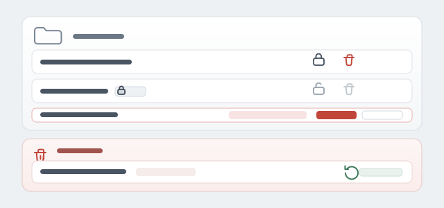

# Session manager

DSH can archive a session, but it cannot delete just one — the only way to clear a session for good
is to delete the whole workspace. This plugin fills that gap.

Open **Settings → 会话删除管理 (Session manager)** and you get every session in the profile, grouped by
workspace, with a lock button and a delete button on each row.

## What it does

- **Every session, grouped by workspace** — workspace name, path, session title and last activity.
  Running sessions and sessions whose log is missing are marked.
- **Lock** — a locked session cannot be deleted; the Host refuses too, so it is not just a disabled button.
  Click again to unlock.
- **Delete with a second confirmation** — the row expands into a confirm bar that tells you exactly what
  will happen, including how long the session stays recoverable. With a buffer of 0 it says outright
  that the deletion cannot be undone.
- **Recycle bin** — confirmed deletions drop to the bottom of the page *and disappear from the left
  workspace list*, because the log file is moved out of the session directory rather than merely archived.
- **Restore** — while the buffer lasts, one click puts the log back where it was. Title, position and
  workspace membership are all unchanged, because the workspace registry never dropped the id.
- **Configurable buffer** — 24 hours by default, `0` means delete immediately after confirmation.
  Range 0–720 hours.
- **Expiry really deletes** — a Host timer (every minute, plus once two seconds after startup) removes
  expired logs, detaches the session from its workspace and clears the archive entry.

## Two-step deletion, step by step

| Stage | What happens to the session | What you see in the left list |
|---|---|---|
| Into the recycle bin | archived + log file moved to `$DSH_HOME/session-manager/trash/<session>/` | gone completely (not greyed out) |
| Restore | log moved back + unarchived | back in its original place |
| Delete for good | trash directory removed + workspace membership detached | no longer exists |

Moving the file matters: archiving alone only greys a row out while **Show archived sessions** is on.
With the file gone from the session directory, the store cannot list it, so the row is not there at all.

Only files starting with `session.` inside that one session's directory are touched; anything else you may
have put there is left alone, and the directory itself is removed only when it ends up empty.

## Where the data lives

`$DSH_HOME/session-manager/state.json` holds the settings, the locks and the buffer entries. Writes are
atomic (temp file + rename), and a corrupted file falls back to defaults instead of breaking startup.
Each trash directory also carries a `meta.json` with the original directory and file list, so the buffer
can still be recovered from disk if `state.json` is lost.

## Known limitations

- A session that is **running** cannot be deleted; the plugin refuses and asks you to stop it first.
- A session that is merely **open** is deferred: it is archived first so it leaves the list, then the
  sweeper moves its log once it leaves memory. `stopActivity` stops activity, it does not save your turn.
- Sessions that never produced a title show as *unnamed*.
- The buffer holds real log files, not archives, so they keep using disk space until expiry or purge.
- **The left list may keep a stale row** after a deletion. That is the DSH client's in-memory snapshot,
  not leftover data: the log directory, the workspace registry and the trash are all clean. DSH emits no
  event for "a session was deleted externally", so the rendered row stays until the client refetches.
  Use the **Reload UI** button on the settings page (it calls `location.reload()`) to clear it.
