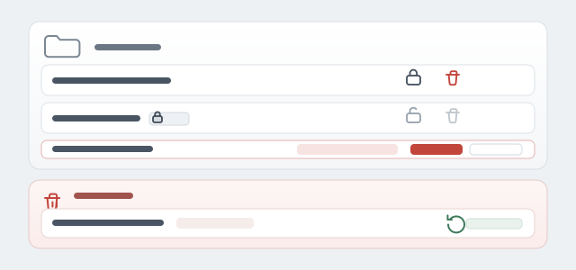

# 会话删除管理

DSH 本身能归档会话，但删不掉单个会话——想彻底清掉一条，只能连整个工作区一起删。
这个插件补的就是这一块。

打开 **设置 → 会话删除管理**，会看到这个配置下所有的会话，按工作区分组，每行一个锁定按钮和一个删除按钮。

## 能做什么

- **按工作区分组列出所有会话**：工作区名称、路径、会话标题、最后活动时间；正在运行的会话和日志缺失的会话都有标记。
- **两层折叠**：点工作区标题行 → 整栏收起只留标题（实心三角，展开 ▼ / 收起 ▶）；
  点标题行右侧的 `5/8` → 这一栏只露前 5 个。这个 5 是固定的，和 DSH 左侧栏自身的
  折叠数字一致（`SESSION_WATERMARK_BASE = 5`）。
- **排序**：列表头部可切「最新在前 / 最早在前」，它决定默认露出来的 5 个是谁
  （排序在截断之前做）。
- **迁移到别的工作区**：每行一个下拉框，选中目标工作区后行内确认即可。真迁移——磁盘上的日志目录一起搬，会话头里的 `cwd` 也改写。
- **锁定**：锁住的会话删不掉，宿主也会拒绝（不是只靠界面禁用）。再点一次解锁。
- **删除要二次确认**：点删除后行内展开确认条，明确写出会发生什么、多少小时内可以回档；
  缓冲时长为 0 时文案直接告诉你无法撤销。
- **删除缓冲站**：二次确认通过的会话落到页面底部，**同时从左侧工作区列表消失**——
  因为日志文件是被移出了会话目录，而不只是加了个归档标记。
- **回档**：缓冲期内点一下就把日志搬回原位，标题、位置、工作区归属都不变，
  因为工作区登记里那个 id 自始至终没被删过。
- **缓冲时长可自定义**：默认 24 小时，填 `0` 就是二次确认后立即彻底删除。范围 0–720 小时。
- **到期真删**：宿主每分钟巡检一次（启动 2 秒后先清一次上一轮的欠账），
  把到期条目的日志删掉、解除工作区归属、清空归档集合。

## 两段式删除具体做了什么

| 阶段 | 对会话做的事 | 左侧列表里的表现 |
|---|---|---|
| 进入缓冲站 | 归档 + 日志文件搬到 `$DSH_HOME/session-manager/trash/<会话>/` | 彻底消失（不是变灰） |
| 回档 | 日志搬回原目录 + 解除归档 | 回到原来的位置 |
| 彻底删除 | 回收站目录整个移除 + 摘掉工作区归属 | 彻底不存在 |

搬文件这一步是关键：只做归档的话，用户开着「显示归档会话」时那一行只会变灰留在原地；
文件不在会话目录里之后，存储层列不出它，这一行才真的不存在。

只动那一个会话目录里以 `session.` 开头的文件，你在旁边放的其他文件一概不碰；
目录空了才一并删掉。

## 数据放在哪

`$DSH_HOME/session-manager/state.json` 保存设置、锁和缓冲站条目。写入是原子的
（临时文件 + 替换），文件损坏时退回默认值而不是让插件起不来。

每个回收站目录里还有一份 `meta.json`，记着原目录和文件清单——`state.json` 万一丢了，
靠它也能还原。

## 迁移到别的工作区

每行有一个下拉框，列出当前 DSH 的所有工作区；选中后行内出现确认条，确认即迁。

这是**真迁移**：DSH 的工作区归属完全由会话头里的 `cwd` 推算（workspace.sessionIds
是个按 cwd 过滤的过滤器，ttachSession 还会在不匹配时抛错），而 cwd 又决定日志文件
在磁盘上的位置。所以插件做两件事：改写会话头的 cwd（只重压第 1 帧，其余帧逐字节保留），
并把会话目录搬到新 cwd 对应的项目目录。

顺序是**先复制、再验证、最后才删原件**：副本要能读回新的 cwd、帧数与原件一致才算成功，
任何一步失败都清掉半成品、原会话保持原样。

**要重启 DSH 才在左侧列表生效**，因为工作区索引是启动时的快照。插件会把这次迁移记进
`pending`，下次启动自动补登记。

**权限不够时**不会偷偷改权限，而是把要做的每一步和两个真实路径摆进对话框，由你选择重试
还是「只改变归属」。后者只改登记、不动磁盘——因为 cwd 没变，DSH 下次按 cwd 过滤时会把
会话摘回「未分组」，插件会如实说明这一点。

被锁定的会话不允许迁移。

## 已知限制

- **正在运行的会话删不掉**：插件会直接拒绝并让你先停掉它。
- 只是**打开着**的会话是「推迟搬运」的：先归档让它从列表消失，等它退出内存后由巡检补搬日志文件；
  `stopActivity` 只停活动，不会替你保存正在跑的回合。
- 从未生成过标题的会话显示为**未命名**。
- 缓冲站里放的是完整日志而不是压缩包，到期或彻底删除之前会一直占着磁盘。
- **左侧列表可能残留一行**：那是 DSH 客户端的内存快照，不是数据没删干净
  （日志目录、工作区登记、回收站都是干净的）。DSH 没有为「会话被外部删除」发事件，
  已经渲染出来的行要等客户端重新拉清单才会消失。用设置页上的 **刷新界面** 按钮
  （它调用 `location.reload()`）即可清掉。
